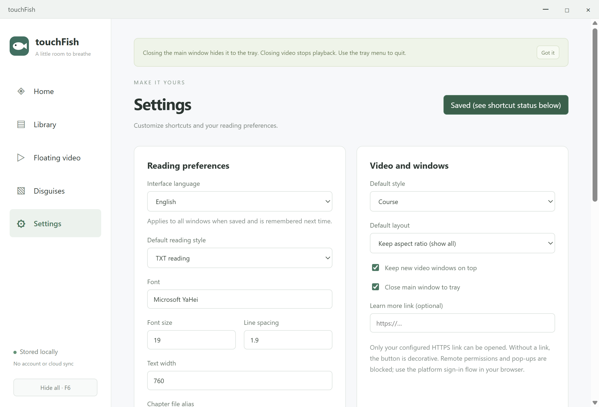
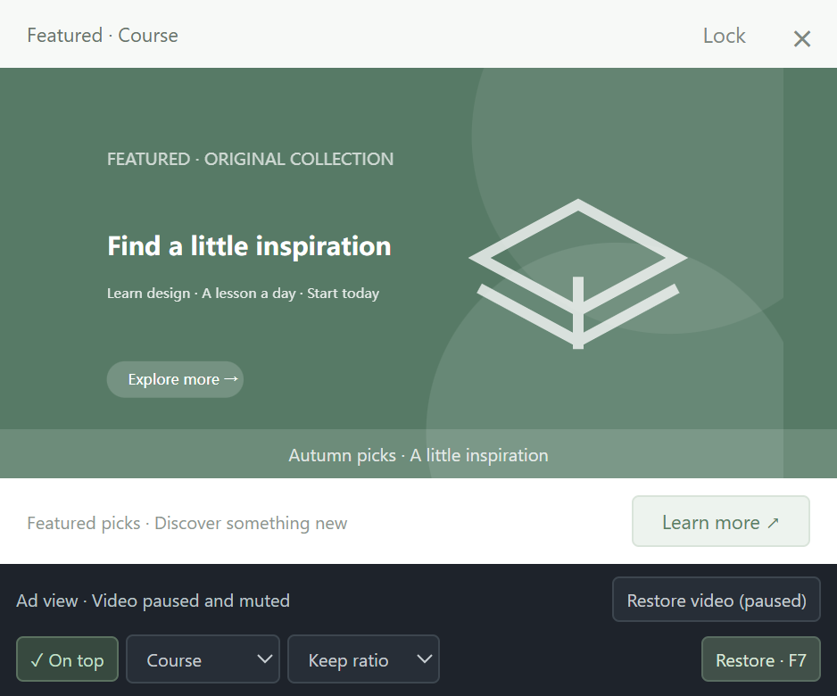
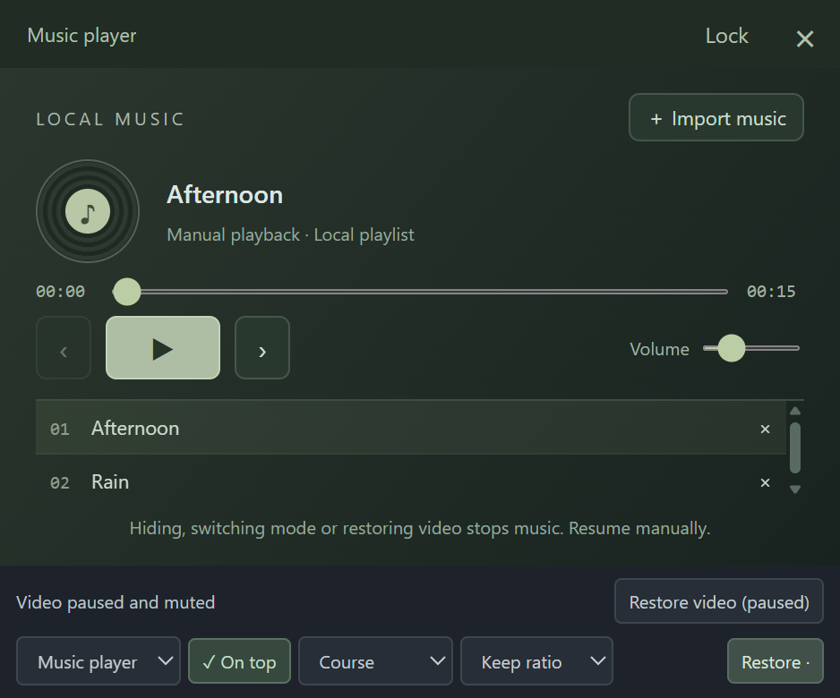

# touchFish

[中文说明](README.md) · **[Download for Windows x64](https://github.com/liny666/touchFish/releases/latest)**

A local desktop app for TXT reading, floating video, visual disguises and quick hiding. This repository contains documentation, screenshots and software downloads. Source code is not published here.

## Download and run

Download **Moyu-1.0.4-win-x64.exe** from the release's **Assets**, then double-click it. You only need this one EXE; no Node.js or other files are required. Initial startup extracts the runtime and may take a few seconds. SHA256SUMS.txt provides the download checksum.

The app is built for Windows x64 and tested on Windows 11. Windows 10 has not been separately tested on another physical device. macOS, Linux and mobile versions are not currently available. The EXE is unsigned, so your system may display a download or startup warning.

**Code → Download ZIP** contains these documents, not the runnable app. Use Releases to download the EXE.

Before upgrading, right-click the existing app's fish icon in the system tray and choose **Quit / 完全退出**, then start the new EXE. Your local books, progress and settings are retained.

## Choose English

The default interface is Simplified Chinese. Open **设置 → 界面语言**, select **English**, then click **保存设置**. All open windows and the tray switch immediately, and the choice is remembered next time.

In English, use **Settings → Interface language → Save settings** to switch back. Book text, book titles, custom artwork and third-party player interfaces keep their original content.

## Features

- **TXT reading:** UTF-8/BOM and GBK/GB18030, chapters, full-text search, bookmarks and saved progress. TXT, VS Code Dark and VS Code Light styles. Imports are local copies; original files stay unchanged.
- **Floating video:** independent frameless windows, always-on-top, position/size lock, volume, mute and seeking. MP4 support depends on the codec; a playable H.264/AAC demo is included.
- **Local crop:** choose **Crop region → Draw again**, drag out a rectangle, adjust its corners or position, then select **Apply crop**. **Full frame** resets it. Cropping changes the display, not the original file.
- **Disguises:** built-in course, shopping, software and work styles, plus custom artwork. Switching to an ad pauses and silences playback; restoring leaves it paused.
- **Online players:** official YouTube and Bilibili embeds. Online cropping is currently disabled. YouTube restores near its last observed position; Bilibili pauses and retains its player and position while hidden/disguised. If pausing fails or times out, it is closed and reloaded at the saved whole-second position where supported. Retention depends on platform page compatibility. Neither resumes automatically. Availability depends on the platform, network and video permissions.

## Clock, timer and local music (v1.0.4)

In **Disguises → Replacement page**, choose Ad, Clock, Timer or Music player, then click **Open replacement page**. No video is required. You can also switch at the bottom of the floating window or save a default in Settings. F7 toggles between video and your selected page; restored video stays paused.

- **Clock:** live local system time and date.
- **Timer:** countdown or stopwatch, start/pause/reset, custom minutes and presets. Time continues across page switches, hiding, sleep and app restarts. Completion is visual and silent.
- **Music player:** import local MP3/WAV/M4A/AAC/OGG/FLAC/Opus files, playlist selection, manual previous/next track, play/pause, seeking and volume. Codec support varies; PCM WAV playback was tested. External music accounts and streaming catalogs are not connected.

Mode, playlist, position, volume and timer state are saved locally. Music files are referenced by their original path; removing a playlist entry does not delete the file. Hiding, minimizing, changing mode, restoring video or closing the window stops music. Resume manually; video and music do not play together.

## Shortcuts and tray

| Default key | Action |
| --- | --- |
| F6 | Hide all windows and stop audio |
| F7 | Switch video and the selected replacement page in the floating window |
| F8 | Restore previously visible windows |

If the top row controls brightness or volume, hold **Fn** with F6/F7/F8. You can also configure modifier shortcuts such as Ctrl+Alt+H in Settings; check that registration succeeds. Number 6 and numpad 6 work only inside focused reader/video windows outside text inputs.

Closing the main window normally hides it to the tray. Right-click the fish icon to show, restore or quit. Closing video stops playback. From v1.0.1 onward, launching the EXE again restores hidden windows and reveals the main window, leaving video paused.

## Local data and plans

Copies, bookmarks, progress, settings and window positions stay on your computer. Settings shows the exact data directory. Deleting the EXE does not remove this data. Clearing imported books does not delete original TXT files. Local videos are referenced by path; choose them again if you move the files.

The English interface and language persistence were verified in real Windows Electron windows. No external novel apps or comics are connected yet. See the [roadmap](docs/FUTURE_IMPLEMENTATION.md) for planned online cropping, external reading platforms/comics, ad improvements, simulated downloads and macOS support.
