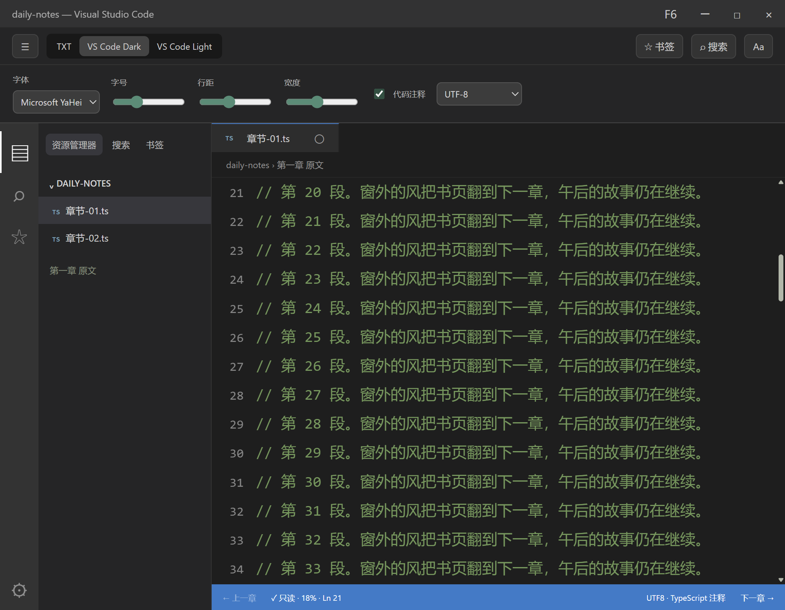
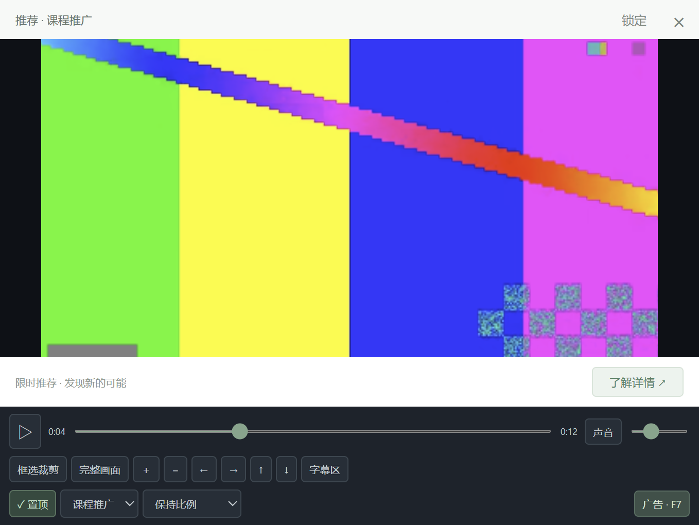

# 摸鱼神器 · touchFish

Windows 桌面阅读与悬浮视频工具，支持 TXT 小说、VS Code 风格阅读、本地视频裁剪、广告伪装，以及一键隐藏和恢复。

A Windows desktop app for TXT reading, VS Code reading styles, floating video, local cropping, visual disguises and quick hiding/restoring.

**[下载 Windows x64 便携版 / Download for Windows x64](https://github.com/liny666/touchFish/releases/latest)** · [后续计划 / Roadmap](docs/FUTURE_IMPLEMENTATION.md) · [English-only README](README.en.md)

此 repo 提供软件说明、截图和版本下载，源代码未公开。首页说明同时提供中文和英文。

This repository provides documentation, screenshots and software downloads. Source code is not published here. This page includes both Chinese and English instructions.

## 下载与运行 / Download and run

在 Release 页面的 **Assets** 中下载 **Moyu-1.0.4-win-x64.exe**（约 100 MB），双击即可运行。只需要一个 EXE，无需安装 Node.js 或下载其他文件。首次启动会自动解压运行资源，可能需要等待几秒。可选下载 **SHA256SUMS.txt** 核对文件校验值。

Download **Moyu-1.0.4-win-x64.exe** (about 100 MB) from the release's **Assets**, then double-click it. You only need this one EXE; no Node.js or other files are required. Initial startup extracts the runtime and may take a few seconds. Optionally use **SHA256SUMS.txt** to verify the download checksum.

适用于 Windows x64，已在 Windows 11 x64 实测；Windows 10 尚未在另一台实体机上单独验收。当前不提供 macOS、Linux 或手机版。EXE 尚未签名，下载或启动时可能出现系统安全提示。

Built for Windows x64 and tested on Windows 11. Windows 10 has not been separately tested on another physical device. macOS, Linux and mobile versions are not currently available. The EXE is unsigned, so your system may display a download or startup warning.

**Code → Download ZIP** 下载的是文档，不是可运行的软件。请到 **Releases** 下载 EXE。

**Code → Download ZIP** contains documentation, not the runnable app. Download the EXE from **Releases**.

## 中英文切换 / Interface language

在 **设置 → 界面语言** 选择 **English** 或 **简体中文**，点击 **保存设置**。所有打开的窗口和托盘立即切换，下次启动记住选择。

The default interface is Simplified Chinese. Open **设置 → 界面语言**, select **English**, then click **保存设置**. All open windows and the tray switch immediately, and the choice is remembered next time.

英文界面中，通过 **Settings → Interface language → Save settings** 修改语言。应用界面、按钮、提示和内置广告支持英文；小说正文、书名、自定义图片及第三方平台界面保留原内容。

In English, use **Settings → Interface language → Save settings** to change the language. App controls, messages and built-in artwork support English. Book text, titles, custom images and third-party player interfaces keep their original content.

## 小说阅读 / TXT reading

在「我的书架」导入 TXT，支持 UTF-8、BOM、GBK / GB18030，单个文件上限 32 MiB；乱码时可手动重新解码。提供 TXT、VS Code Dark、VS Code Light 三种外观，支持章节目录、全文搜索、书签和阅读进度保存。

Import TXT files in **Library**. UTF-8/BOM and GBK/GB18030 are supported, with a 32 MiB limit per file. If text is garbled, select its encoding manually. Choose TXT, VS Code Dark or VS Code Light, with chapters, full-text search, bookmarks and saved progress.

导入的是本地副本，原文件不变；书名和项目别名可以修改。附带原创短篇《午后列车》。当前没有接入番茄小说等外部 App，也没有漫画阅读功能。

Imports are local copies; originals stay unchanged. Book titles and editor project aliases can be edited. An original Chinese short story, *Afternoon Train*, is included. External novel apps and comic reading are not connected yet.

## 悬浮视频与本地裁剪 / Floating video and local cropping

在「悬浮视频」选择本地文件，或打开附带的 12 秒 MP4 演示。独立窗口支持拖动、缩放、置顶、锁定、播放/暂停、音量、静音和进度调整。MP4 支持取决于具体编码。

Choose a local file in **Floating video**, or try the included 12-second MP4 demo. The independent window supports moving, resizing, always-on-top, position/size lock, play/pause, volume, mute and seeking. MP4 support depends on the codec.

裁剪步骤：**框选裁剪 → 重新框选 → 拖出矩形 → 调整四角或拖动选区 → 确认裁剪**。

To crop: **Crop region → Draw again → draw a rectangle → adjust its corners or position → Apply crop**.

「完整画面」重置裁剪，另有放大、平移和「字幕区」预设。裁剪只改变显示区域，不修改原视频文件。纯视频模式下控件会淡出，移动鼠标即可显示。

**Full frame** resets cropping. Zoom, pan and a **Subtitles** preset are available. Cropping changes the display, not the original file. Controls fade out in video-only mode; move the mouse to show them.

## 在线视频 / Online video

支持 YouTube 链接、Bilibili BV 链接/BV 号及分 P 参数。b23 短链需先在浏览器展开。使用官方播放器，当前在线来源不支持裁剪和拉伸。

YouTube links, Bilibili BV links/IDs and multi-part selection are supported. Expand b23 short links in your browser first. Official platform players are used; online cropping and stretching are currently disabled.

YouTube 隐藏或切换广告后会重建播放器，按最近读取的位置恢复，精度约一秒。v1.0.3 起，Bilibili 会先静音、移出画面并暂停，正常切换时保留原播放器和观看位置，切回后需手动继续播放。暂停失败或超时会关闭播放器，恢复时尝试从保存的整秒位置重建。该保留功能依赖平台页面兼容性；播放仍受视频权限和网络影响。

YouTube is rebuilt after hiding/disguising and restores near the last observed position (about one-second precision). From v1.0.3, Bilibili is natively muted, detached and paused, retaining the same player and position during normal switching. Resume playback manually after restoring. If pausing fails or times out, the player is closed and reloaded at the saved whole-second position where supported. Retention depends on compatibility with the platform page; video permissions and network still affect playback.

## 时钟、计时器与音乐 / Clock, timer and music

v1.0.4 起，在 **伪装皮肤 → 替代页面** 选择广告、时钟、计时器或音乐播放器，点击 **打开替代页面**；无需先选视频。悬浮窗口底部也能切换，设置中可保存默认页面，F7 在视频和选中页面之间切换。

From v1.0.4, choose **Disguises → Replacement page → Ad / Clock / Timer / Music player → Open replacement page**. No video is required. Switch at the bottom of the floating window or save a default in Settings. F7 toggles video and the selected page.

时钟显示本地时间与日期。计时器提供倒计时、秒表、暂停与重置，隐藏、切页或重启后按实际经过时间继续，到时仅显示提示。音乐播放器提供本地歌单、手动上一首／下一首、播放暂停、进度与音量，支持 MP3、WAV、M4A 等格式，实际解码能力取决于编码；未接入外部音乐账号和在线曲库。

The clock shows local time and date. Countdown and stopwatch support pause/reset and keep time across hiding, page switches and restarts, with silent visual completion. The music player provides a local playlist, manual previous/next, play/pause, seeking and volume. MP3, WAV, M4A and other formats are accepted; codec support varies. External music accounts and streaming catalogs are not connected.

隐藏、最小化、换模式或切回视频会停止音乐，恢复后手动播放。视频和音乐不会同时播放。页面选择、歌单和计时状态保存在本机；歌单按原路径引用文件，移除条目不会删除原音频。

Hiding, minimizing, changing mode or restoring video stops music. Resume manually; video and music do not play together. Mode, playlist and timer state stay on your computer. Tracks reference their original paths; removing a playlist entry does not delete the audio file.

## 广告伪装与快捷键 / Disguises and shortcuts

可选择课程、商品、软件或工作面板外观，也可导入自定义广告图片。同一个视频窗口切换广告后停止声音，恢复时视频保持暂停。

Choose a course, shopping, software or work style, or import custom artwork. Switching the video window to an ad pauses and silences playback. Restoring leaves video paused.

| 默认按键 / Default key | 中文动作 | English action |
| --- | --- | --- |
| F6 | 隐藏全部窗口，停止声音 | Hide all windows and stop audio |
| F7 | 切换视频与选中的替代页面 | Switch video and the selected replacement page |
| F8 | 恢复隐藏前可见的窗口 | Restore previously visible windows |

如果顶排按键控制亮度或音量，请使用 **Fn + F6 / F7 / F8**。也可在设置中改为 Ctrl+Alt+H、Ctrl+Alt+J、Ctrl+Alt+K，保存后检查注册结果。被其他软件占用的按键会显示注册失败。

If the top row controls brightness or volume, hold **Fn** with F6/F7/F8. You can also configure Ctrl+Alt+H, Ctrl+Alt+J or Ctrl+Alt+K in Settings. Save and check registration status; shortcuts already used by another app may fail to register.

普通数字 6 和小键盘 num6 仅在阅读/视频窗口有焦点、且不在文本输入中时生效，不是全局快捷键。

Number 6 and numpad 6 work only in focused reader/video windows outside text inputs. They are not global shortcuts.

## 托盘、恢复与更新 / Tray, restoring and updates

主窗口关闭默认隐藏到托盘。右键鱼图标可显示主窗口、恢复、隐藏、进入设置或完全退出；视频窗口关闭会停止播放。

Closing the main window normally hides it to the system tray. Right-click the fish icon to show, restore, hide, open Settings or quit. Closing video stops playback.

**v1.0.1 起，隐藏后再次双击 EXE 即可恢复窗口。** 最小化的主窗口也会还原，视频保持暂停。也可用 F8（或 Fn + F8）和托盘菜单恢复。

**From v1.0.1 onward, launching the EXE again restores hidden windows.** A minimized main window is restored too, and video stays paused. You can also use F8 (or Fn + F8) or the tray menu.

**更新前，先在托盘选择「完全退出」，再启动新版 EXE。** 书架、进度和设置继续保留。旧版仍在运行时会接收新版的启动请求。

**Before updating, choose Quit / 完全退出 from the tray, then start the new EXE.** Books, progress and settings are retained. An old instance that is still running will receive the new launch request.

## 数据保存 / Local data

小说副本、书签、阅读/视频进度、设置和窗口位置保存在本机，设置页显示准确的数据目录。删除 EXE 不会删除个人数据；清除导入小说不会删除原始 TXT。本地视频按原文件路径保存，移动后需重新选择。

Book copies, bookmarks, progress, settings and window positions stay on your computer. Settings shows the data directory. Deleting the EXE does not remove this data; clearing imported books does not delete original TXT files. Local videos are referenced by path; choose them again after moving them.

完全退出应用后，手动删除设置页显示的数据目录可清除本地副本、缓存和设置。

After quitting the app, deleting the data directory shown in Settings removes local copies, caches and settings.

## 验证与后续计划 / Verification and roadmap

v1.0.3 通过 17 项核心测试，并在真实 B 站视频约 65 秒处验证广告切换、隐藏恢复和快速切换保留进度；模拟暂停失败后，也验证了关闭播放器及从保存位置重新播放。

v1.0.3 passed 17 core tests. A real Bilibili video was tested around the 65-second mark for position retention across ads, hiding and rapid toggles. Injected pause failure also verified destruction and playback from the saved position.

v1.0.2 通过 12 项核心/本地化测试和 5 组真实 Electron 语言验收。解包版与单文件便携版均实测语言切换、MP4 播放、隐藏后再次启动恢复和退出。首版还完成了阅读、快捷键、原生对话框等桌面与边界验收，并用具体样例验证两个官方在线平台实际播放。

v1.0.2 passed 12 core/localization tests and five real Electron language checks. Both unpacked and portable EXEs were tested for language switching, MP4 playback, restoring after relaunch and quitting. The first version also completed desktop and edge-case checks for reading, shortcuts and native dialogs, and verified actual playback with specific examples on both online platforms.

尚未完整验收 Windows 10、其他 DPI、多显示器热插拔和大型单章文本压力场景；样例播放成功不代表所有在线链接可用。

Windows 10, other DPI settings, monitor hot-plugging and large single-chapter text stress cases have not been fully tested. Successful sample playback does not guarantee that every online link works.

中英文界面已完成。后续计划包括在线视频裁剪、外部小说平台及漫画、广告界面优化、模拟软件下载和 macOS 适配；这些尚未实现。

The Chinese/English interface is available. Planned work includes online cropping, external novel platforms/comics, ad UI improvements, a simulated software download view and macOS support. These features are not available yet.

[查看后续计划 / View the roadmap](docs/FUTURE_IMPLEMENTATION.md)
